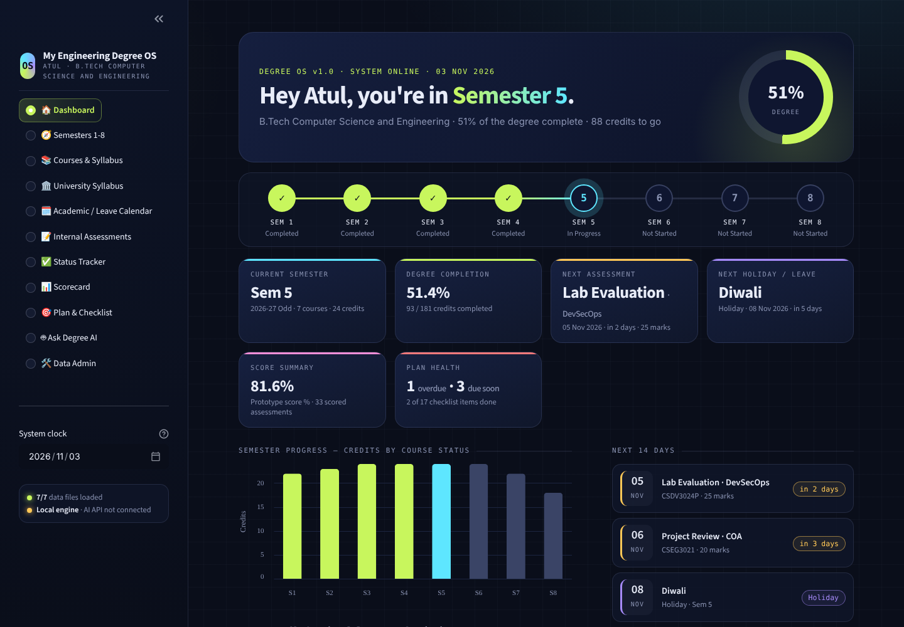

# 🎓 My Engineering Degree OS

A self-managed **Semester 1 → Semester 8** command center for a B.Tech student: schedules, syllabus, assessments, progress, scorecard, plan/checklist and a grounded AI chatbot — all driven by simple CSV files.

Built with **Python + Streamlit + Pandas**, optional **Gemini (google-genai)** for the chatbot, deployable free on **Streamlit Community Cloud**.



---

## What's inside (12 pages)

| #   | Page                          | What it does                                                                                                                                                                              |
| --- | ----------------------------- | ----------------------------------------------------------------------------------------------------------------------------------------------------------------------------------------- |
| 01  | **Dashboard**                 | Hero with degree-completion ring, 8-semester journey track, current semester, completion %, next assessment, next holiday, prototype score, plan health, credits chart, next-14-days feed |
| 02  | **Semesters 1-8**             | Eight "module" cards (course count, credits, status, progress ring) + inspector with courses / assessments / calendar tabs                                                                |
| 03  | **Courses & Syllabus**        | Semester switcher, status filter, search, table + syllabus topic cards                                                                                                                    |
| 04  | **University Syllabus**       | Programme overview, every field with a **source/reference**, editable syllabus link, structure computed from courses                                                                      |
| 05  | **Academic / Leave Calendar** | Filter by academic year, semester, event type; timeline; month-grouped list                                                                                                               |
| 06  | **Internal Assessments**      | IA1, IA2, assignments, lab evaluations, project reviews, mid/end-sem — timeline + days-left                                                                                               |
| 07  | **Status Tracker**            | Not Started / In Progress / Completed counts, progress bar, kanban board, whole-degree charts                                                                                             |
| 08  | **Scorecard**                 | Semester % and cumulative % (clearly labelled **prototype score percentage**, not CGPA), grade distribution, course detail                                                                |
| 09  | **Plan & Checklist**          | This Week · Semester Milestones · Degree Milestones, Done / Due Soon / Overdue health, editable with `st.data_editor`                                                                     |
| 10  | **Ask Degree AI**             | Grounded chatbot: Gemini when a key exists, deterministic local engine otherwise, safety layer for university rules, shows data area used                                                 |
| 11  | **Data Admin**                | Edit any CSV in a grid, validation, save with automatic backup, download, upload-replace, credit sync                                                                                     |

The sidebar **System clock** lets you preview the OS on any date (handy for demos and testing).

---

## Phase 1 — Set up (local)

```bash
cd engineering-degree-os
python -m pip install -r requirements.txt
python -m streamlit hello          # optional environment check
python -m streamlit run app.py
```

**Browser-only alternative:** push this folder to GitHub → _Code → Codespaces → Create codespace_ → run the same commands in the Codespaces terminal.

## Phase 2 — Data model (`data/`)

| File                      | Purpose                                                                                             |
| ------------------------- | --------------------------------------------------------------------------------------------------- |
| `semesters.csv`           | Semester 1–8 status and credits                                                                     |
| `courses.csv`             | Code, name, short name, credits, faculty, syllabus topics (`;`-separated), status                   |
| `academic_calendar.csv`   | Academic / Exam / Holiday / Leave events with academic_year + semester                              |
| `assessments.csv`         | IA1, IA2, Assignment, Lab Evaluation, Project Review, Mid/End Semester                              |
| `scores.csv`              | Marks and grades (2 completed semesters + Sem 3 mid-sems)                                           |
| `plan_checklist.csv`      | category, item, target_date, status, notes, scope (Semester / Degree)                               |
| `university_syllabus.csv` | Programme fields + source/reference. Official CGPA formula and regulations are intentionally blank. |

All dates are `YYYY-MM-DD`. Calendar dates and syllabus topics are **sample data** — replace them with your official university documents.

## Phase 6 — Gemini (optional)

1. Create a free key at **aistudio.google.com/apikey**.
2. **Easiest:** open **Ask Degree AI → 🔑 Connect Gemini**, paste the key, press **Connect**. The app tests the key and (if "Remember on this computer" is ticked) saves it to `.streamlit/secrets.toml`.
3. Manual alternative: copy `.streamlit/secrets.toml.example` → `.streamlit/secrets.toml` and paste the key.
4. Deployed app: Streamlit Cloud → App → **Settings → Secrets** → `GEMINI_API_KEY = "..."`.
5. Never commit `secrets.toml` (already in `.gitignore`).

Without a key, the chatbot still answers incomplete courses, next assessment, next holiday, course topics, semester status, scores and checklist status from the CSVs, and shows **"AI API not connected"** for questions needing generation.

## Phase 8 — Deploy (≈5 min)

1. Create a GitHub repo named `engineering-degree-os` and upload everything **except** `.streamlit/secrets.toml`:
   ```bash
   git init && git add . && git commit -m "Engineering Degree OS v1"
   git branch -M main
   git remote add origin https://github.com/<your-username>/engineering-degree-os.git
   git push -u origin main
   ```
2. Open **share.streamlit.io** → sign in with GitHub → **Create app** → choose the repo → branch `main` → file `app.py` → **Deploy**.
3. (If using Gemini) App → **Settings → Secrets** → paste `GEMINI_API_KEY = "..."` → Save.
4. Open the `*.streamlit.app` URL in a new window and ask one chatbot question.

> Note: on Streamlit Cloud, Data Admin edits persist until the app restarts. Commit the updated CSVs (Download CSV button) to make them permanent.

## Supabase — Cloud Feedback (permanent, per-user storage)

Flow: **browser form → Streamlit (Python) → Supabase API → PostgreSQL table `public.app_feedback`**.
Students sign in, save a name + message, and see only their own saved feedback. Row Level Security in the database enforces ownership; records survive app restarts.

| Item | Value |
|---|---|
| Supabase project | `princi143's Project` · ref `hxhvyujyzkjhrgefinoz` · region ap-south-1 (Mumbai) |
| Table + policies | `supabase/schema.sql` (applied via SQL Editor on 22 Nov 2026) |
| Page | **☁️ Cloud Feedback** (12th item in the sidebar) |

**Setup**
1. Supabase dashboard → **Authentication → Users → Add user → Create new user** (tick *Auto Confirm User*). Create two test accounts.
2. Create `.streamlit/secrets.toml` (copy `secrets.toml.example`) with:
   ```toml
   SUPABASE_URL = "https://hxhvyujyzkjhrgefinoz.supabase.co"
   SUPABASE_PUBLISHABLE_KEY = "sb_publishable_..."   # Settings → API Keys → publishable
   ```
3. `python -m pip install -r requirements.txt` then `python -m streamlit run app.py` → open **☁️ Cloud Feedback**, sign in, Save.
4. Streamlit Cloud: paste the same two lines into **App → Settings → Secrets**.

Use only the **publishable** key — secret / service_role keys bypass RLS. The Supabase client is kept per browser session (`st.session_state`), never in a global cache.

## Troubleshooting

| Problem                        | Fix                                                                          |
| ------------------------------ | ---------------------------------------------------------------------------- |
| `streamlit: command not found` | `python -m pip install streamlit` then `python -m streamlit run app.py`      |
| CSV not found                  | The app shows a friendly warning; check the `data/` folder and file names    |
| Column not found               | Compare CSV headers with the required columns shown on Data Admin            |
| Chatbot fails on cloud         | Add `GEMINI_API_KEY` in app Secrets; the local engine still works without it |
| Supabase: missing secrets / KeyError | Check `.streamlit/secrets.toml` spelling + quotes, restart the app |
| Supabase: sign-in fails | Use the app user from Authentication → Users (not your dashboard login); make sure it is confirmed |
| Supabase: empty list, no error | That account has no rows yet — RLS hides other users' rows |
| Gemini rate limit              | The app automatically falls back to the local engine                         |

See `TESTING.md` for the evidence log and `SUBMISSION.md` for the submission sheet.

<!-- Local development setup verified on November 13, 2026 -->
